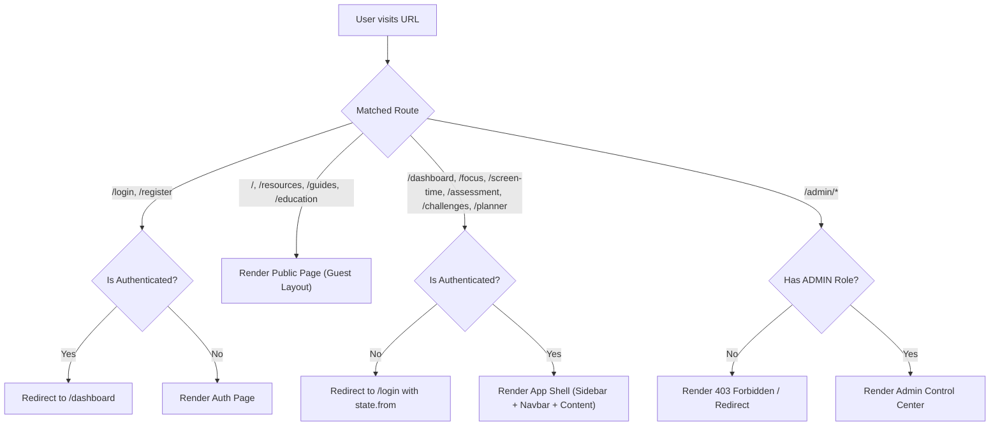
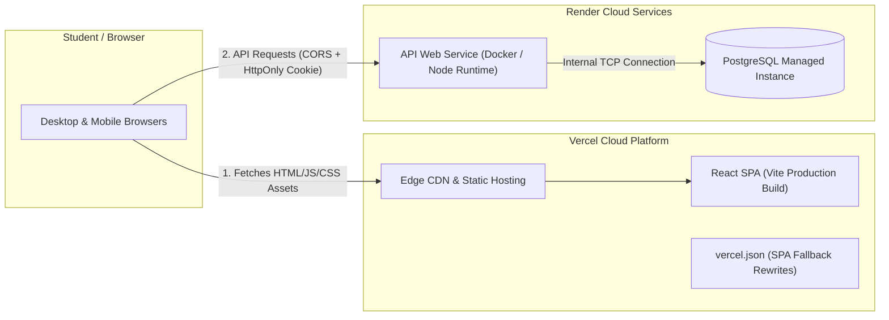

# System Architecture Document

## Digital Wellness Hub
**Document Version:** 1.0.0  
**Pattern:** Decoupled Client-Server Modular Monolith  
**Frontend:** React / TypeScript / Vite / Tailwind CSS / React Router / Recharts  
**Backend:** Node.js / Express.js / TypeScript / Prisma ORM / PostgreSQL  
**Deployment Target:** Vercel (Client) + Render (API & PostgreSQL)

---

## 1. Architectural Philosophy & Overview

Digital Wellness Hub is engineered as a **decoupled modular monolith**. The user-facing client and backend application service are maintained in separate, specialized directories with isolated compilation pipelines, while the backend maintains clear internal domain boundaries.

```mermaid
flowchart TD
    subgraph ClientLayer ["Client Layer (Vercel CDN)"]
        SPA["React 18+ SPA (Vite + TS)"]
        Router["React Router v6/v7 (Guarded Routes)"]
        Features["Feature Modules (Auth, Dashboard, Focus, etc.)"]
        State["Client State & Server-Cache"]
        SPA --> Router --> Features --> State
    end

    subgraph GatewayLayer ["Network & Security Boundary"]
        CORS["CORS Policy & Helmet Security Headers"]
        RateLimit["Express Rate Limiter"]
        CookieParser["Cookie Parser (HttpOnly Auth Tokens)"]
    end

    subgraph BackendLayer ["Application Layer (Render Web Service)"]
        ExpressApp["Express.js App Router (/api/v1)"]
        AuthMid["Auth & RBAC Middleware"]
        ValMid["Zod Request Validation Middleware"]

        subgraph Modules ["Domain Modules"]
            AuthMod["Auth Module"]
            UserMod["User & Profile Module"]
            ResMod["Resources & Comparison Module"]
            GuideMod["Device Guides Module"]
            FocusMod["Focus Sessions Module"]
            ScreenMod["Screen-Time Tracking Module"]
            AssessMod["Wellness Assessment Module"]
            ChalMod["Challenges Module"]
            PlanMod["Daily Planner Module"]
            AdminMod["Admin Moderation Module"]
        end

        subgraph LayeredPattern ["Uniform Module Architecture"]
            Routes["*.routes.ts"] --> Controllers["*.controller.ts"]
            Controllers --> Services["*.service.ts"]
            Services --> Repositories["*.repository.ts"]
        end
    end

    subgraph DataLayer ["Persistence Layer (PostgreSQL on Render)"]
        Prisma["Prisma ORM Client (Connection Pool)"]
        Postgres[(PostgreSQL Database)]
        Prisma --> Postgres
    end

    State -- "HTTPS REST API (JSON + Cookies)" --> GatewayLayer
    GatewayLayer --> ExpressApp
    ExpressApp --> AuthMid --> ValMid --> Modules
    Modules --> LayeredPattern
    Repositories --> Prisma
```



### Architectural Key Benefits
1. **Separation of Concerns:** Frontend engineers work purely in browser DOM, reactive UI, and visualization. Backend engineers focus on business invariants, validation, transactional integrity, and database performance.
2. **Domain Isolation:** Each backend module handles its own business rules, allowing independent evolution without leaky abstractions.
3. **Zero Distributed Systems Overhead:** By avoiding microservices, we eliminate distributed transactions, network latency between microservices, gRPC overhead, and complex service mesh management.
4. **Independent Scalability & Deployment:** The frontend deploys to edge CDN nodes on Vercel with instant cache invalidation, while the Node.js backend runs on Render with autoscaling options.

---

## 2. Frontend Architecture (React + Vite + TypeScript)

### 2.1 Feature-Based Code Organization

The client utilizes a **feature-first** modular structure. Code is co-located by domain rather than split by arbitrary technical layers:

```
client/
├── public/                     # Static assets, favicon, manifest
├── src/
│   ├── assets/                 # SVGs, images, static icons
│   ├── components/             # Global, shared UI components
│   │   ├── ui/                 # Atomic design elements (Button, Card, Modal, Input, Badge)
│   │   ├── layout/             # Shell layouts (Navbar, Sidebar, Footer, PageHeader)
│   │   └── feedback/           # Toasts, AlertBanners, LoadingSpinners, SkeletonLoaders
│   ├── config/                 # Environment configs, API endpoints, constants
│   ├── context/                # Global contexts (AuthContext, ThemeContext)
│   ├── features/               # Domain-driven feature packages
│   │   ├── auth/               # Login, Register, ForgotPassword, AuthCallback
│   │   │   ├── api/            # authApi.ts (login, register, logout, refreshToken)
│   │   │   ├── components/     # LoginForm, RegisterForm, PasswordStrengthMeter
│   │   │   ├── hooks/          # useAuth.ts
│   │   │   ├── types/          # auth.types.ts
│   │   │   └── pages/          # LoginPage.tsx, RegisterPage.tsx
│   │   ├── dashboard/          # Student home dashboard, KPI widgets
│   │   ├── resources/          # Resource directory, comparisons, filters
│   │   ├── guides/             # Interactive step-by-step device guides
│   │   ├── focus/              # Focus timer, session logging, reflection modal
│   │   ├── screen-time/        # Manual screen-time logging, categories, goal charts
│   │   ├── assessments/        # Multi-step questionnaire, diagnostic tier report
│   │   ├── challenges/         # Streak tracking, active challenges, badge showcase
│   │   ├── planner/            # Daily intentions, shutdown routine checklist
│   │   ├── education/          # Public articles, digital minimalism guides
│   │   └── admin/              # Resource verification, content CRUD, metrics
│   ├── hooks/                  # Global utility hooks (useDebounce, useMediaQuery, useLocalStorage)
│   ├── lib/                    # Third-party wrappers (apiClient, formatters, dateUtils)
│   ├── routes/                 # Route declarations & route guards
│   │   ├── AppRoutes.tsx       # Central route configuration
│   │   ├── ProtectedRoute.tsx  # Requires authenticated STUDENT or ADMIN
│   │   ├── AdminRoute.tsx      # Requires ADMIN role
│   │   └── PublicOnlyRoute.tsx # Redirects logged-in users to dashboard
│   ├── types/                  # Global shared TypeScript definitions
│   ├── App.tsx                 # Root application component
│   ├── main.tsx                # Application entrypoint
│   └── index.css               # Tailwind CSS directives & custom utility classes
├── index.html                  # HTML5 shell
├── package.json
├── tailwind.config.js          # Design system theme tokens
├── tsconfig.json
└── vite.config.ts              # Vite bundler build options & path aliases
```

### 2.2 Client Routing & Guards Strategy

Client-side routing is powered by **React Router (v6/v7)** with hierarchical route protection:



### 2.3 State Management & Data Fetching Strategy

- **Authentication State:** Managed via `AuthContext` (React Context API), holding current user profile, initialization state (`isBootstrapping`), and login/logout methods.
- **Server Cache & Async State:** Custom type-safe API client wrappers (`apiClient.ts` based on native `fetch` or `axios`) featuring automatic 401 interception, transparent token refreshing, and localized query hooks (`useFetch`, `useMutation`).
- **Form State:** Controlled inputs paired with client-side Zod schema validation to match server-side validation schemas.
- **Local Ephemeral State:** React `useState` and `useReducer` for UI states (e.g., timer ticking, active tabs, modal open/close).

### 2.4 Design System Tokens & Visualization

- **Color Palette:** Curated for digital calm and reduced eye strain:
  - Deep Navy / Slate background foundations (`slate-900`, `slate-800` for dark accents).
  - Sage / Emerald accents (`emerald-600`, `teal-500`) symbolizing wellness, balance, and focus.
  - Soft amber/coral accents for warnings without inducing anxiety.
- **Data Visualization (Recharts):**
  - Fully responsive SVG containers (`ResponsiveContainer`).
  - Screen-time comparison: Dual-bar charts (Goal vs. Actual).
  - Habit trends: Area charts with gradient fills.
  - Assessment radar: 4-axis Polar chart representing wellness dimensions.

---

## 3. Backend Architecture (Node.js + Express.js + TypeScript)

### 3.1 Layered Modular Pattern

The backend is arranged into strictly decoupled domain modules. Each domain module implements a predictable 5-layer hierarchy:

```
server/
├── src/
│   ├── config/                 # Environment variables, constants, prisma instance
│   │   ├── env.ts              # Zod-validated process.env config
│   │   └── prisma.ts           # Shared PrismaClient singleton instance
│   ├── middleware/             # Global Express middlewares
│   │   ├── auth.middleware.ts  # JWT verification & payload attachment
│   │   ├── role.middleware.ts  # RBAC enforcement (requireRole(['ADMIN']))
│   │   ├── validate.middleware.ts # Zod request validation (body, query, params)
│   │   ├── error.middleware.ts # Centralized exception handling & JSON formatting
│   │   ├── rateLimiter.middleware.ts # IP-based request throttling
│   │   └── logging.middleware.ts # Request/response latency logging
│   ├── modules/                # Domain-driven business modules
│   │   ├── auth/
│   │   │   ├── auth.routes.ts
│   │   │   ├── auth.controller.ts
│   │   │   ├── auth.service.ts
│   │   │   ├── auth.repository.ts
│   │   │   ├── auth.validation.ts
│   │   │   └── auth.types.ts
│   │   ├── user/
│   │   ├── resources/
│   │   ├── guides/
│   │   ├── focus/
│   │   ├── screen-time/
│   │   ├── assessments/
│   │   ├── challenges/
│   │   ├── planner/
│   │   └── admin/
│   ├── types/                  # Global Express type extensions
│   │   └── express.d.ts        # Extends Express.Request with req.user
│   ├── utils/                  # Cryptography, tokens, response formatters
│   │   ├── argon2.util.ts      # Password hashing & verification
│   │   ├── jwt.util.ts         # Sign & verify access/refresh tokens
│   │   └── apiResponse.util.ts # Standardized JSON envelope helpers
│   ├── app.ts                  # Express app setup, middleware registration
│   └── server.ts               # HTTP server listener & graceful shutdown
├── prisma/
│   ├── schema.prisma           # Prisma relational schema
│   ├── migrations/             # Auto-generated SQL migration history
│   └── seed.ts                 # Database seeder (admin, default resources, guides)
├── package.json
└── tsconfig.json
```

### 3.2 Responsibility Matrix per Layer

| Layer | Responsibility | What it NEVER does |
| :--- | :--- | :--- |
| **Routes** | Defines HTTP verbs, paths, and binds middleware chain (Auth -> Role -> Validate -> Controller). | No business logic; no database queries. |
| **Controllers** | Extracts HTTP request data (`body`, `query`, `params`), passes to service, returns standard JSON response envelope. | No direct database access; no password hashing. |
| **Services** | Implements core domain rules, transactions, calculations (e.g., wellness score algorithms, streak evaluations). | Does not know about HTTP (`req`, `res`, status codes). |
| **Repositories** | Direct interaction with database via Prisma client queries; abstracts data storage mechanism. | No HTTP awareness; no domain orchestration. |
| **Validation** | Zod schemas validating schema conformance before requests ever reach the controller. | No side effects. |

---

## 4. REST API Conventions & Standards

### 4.1 Base Path & Versioning
All backend endpoints are prefixed with the API version:
```
https://api.digitalwellnesshub.edu/api/v1/{resource}
```

### 4.2 Resource URL Naming Conventions
- Plural nouns for resource collections: `/api/v1/resources`, `/api/v1/focus-sessions`.
- Kebab-case for multi-word paths: `/api/v1/screen-time`, `/api/v1/wellness-assessments`.
- Hierarchical sub-resources when owned by a parent:
  - `POST /api/v1/resources/:resourceId/reviews`
  - `GET /api/v1/challenges/:challengeId/enrollment`

### 4.3 Standard JSON Response Envelopes

To maintain client predictability, all responses conform to standard JSON contracts:

#### Success Envelope (`200 OK`, `201 Created`):
```json
{
  "success": true,
  "data": {
    "id": "res_01HXYZ...",
    "title": "Forest App",
    "pricingModel": "FREEMIUM"
  },
  "meta": {
    "page": 1,
    "limit": 20,
    "total": 85,
    "totalPages": 5
  }
}
```

#### Error Envelope (`400`, `401`, `403`, `404`, `422`, `500`):
```json
{
  "success": false,
  "error": {
    "code": "VALIDATION_ERROR",
    "message": "Invalid input parameters provided.",
    "details": [
      {
        "field": "email",
        "message": "Must be a valid email format."
      }
    ]
  }
}
```

### 4.4 HTTP Status Code Standards

| Code | Status | Usage in Digital Wellness Hub |
| :--- | :--- | :--- |
| **200** | OK | Standard successful response for GET, PUT, PATCH. |
| **201** | Created | Resource successfully created (POST). |
| **204** | No Content | Successful deletion with no body returned. |
| **400** | Bad Request | Malformed JSON syntax or missing required parameters. |
| **401** | Unauthorized | Missing, expired, or invalid authentication token. |
| **403** | Forbidden | Valid token but insufficient role permissions (e.g. Student hitting Admin route). |
| **404** | Not Found | Resource ID does not exist in database. |
| **409** | Conflict | Duplicate unique field (e.g. email already registered). |
| **422** | Unprocessable Entity | Zod validation failure on request payload. |
| **429** | Too Many Requests | Rate limit throttled. |
| **500** | Internal Server Error | Unhandled runtime exception (generic message returned to client). |

### 4.5 Standard Query Parameters

- **Pagination:** `?page=1&limit=20` (default limit: 20, max limit: 100).
- **Sorting:** `?sortBy=createdAt&sortOrder=desc`.
- **Filtering:** `?category=ATTENTION&pricing=OPEN_SOURCE&search=blocker`.

---

## 5. Deployment & Infrastructure Topology



### 5.1 Cross-Origin & Cookie Configuration Strategy
Because the frontend (Vercel) and backend (Render) operate on different hostnames in production:
- In production, cross-origin cookies require:
  - `SameSite: "None"`
  - `Secure: true`
  - Explicit CORS headers specifying the exact Vercel origin with `credentials: true`.
- In development, cookies utilize `SameSite: "Lax"`, `Secure: false` on `localhost`.

### 5.2 Environment Configuration Table

| Environment Variable | Service | Purpose |
| :--- | :--- | :--- |
| `NODE_ENV` | Backend | `development` / `production` / `test` |
| `PORT` | Backend | Default `5000` (or injected by Render) |
| `DATABASE_URL` | Backend | PostgreSQL connection string with SSL mode |
| `JWT_ACCESS_SECRET` | Backend | 256-bit cryptographically secure key |
| `JWT_REFRESH_SECRET` | Backend | 256-bit cryptographically secure key |
| `CORS_ORIGIN` | Backend | Allowed client origins (e.g. `https://digital-wellness-hub.vercel.app`) |
| `VITE_API_URL` | Frontend | API root URL (e.g. `https://digital-wellness-api.onrender.com/api/v1`) |
