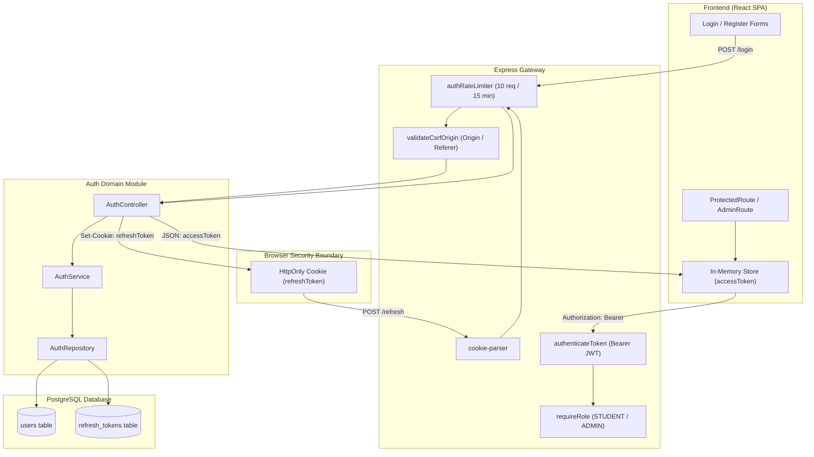

# Authentication & Identity Architecture Specification (Phase 2)

## Digital Wellness Hub — "Your Digital Life. Your Rules."
**Document Version:** 1.0.0  
**Security Standard:** OWASP Top 10 Aligned  
**Cryptographic Primitives:** Argon2id, JWT (HS256 / RS256), SHA-256 Hashes

---

## 1. Architectural Overview

Digital Wellness Hub implements a **dual-token authentication and session management architecture** designed to eliminate credential theft, mitigate Cross-Site Scripting (XSS), and prevent Cross-Site Request Forgery (CSRF).



---

## 2. Core Security Guarantees

| Security Concern | Threat Vector | Mitigation in Digital Wellness Hub |
| :--- | :--- | :--- |
| **Password Cracking** | GPU / ASIC brute forcing, dictionary attacks | **Argon2id** password hashing with memory cost `65536 KiB`, time cost `3` iterations, parallelism `4` threads. |
| **XSS Credential Theft** | Malicious scripts reading tokens from `localStorage` | Access tokens exist **strictly in application memory**; refresh tokens exist exclusively in **`HttpOnly` cookies** invisible to JavaScript. |
| **CSRF** | Cross-origin form submission or image tags | State-changing endpoints are guarded by `validateCsrfOrigin`, strict CORS whitelisting, and `SameSite` cookie flags. |
| **Token Replay / Theft** | Stolen refresh tokens reused by an adversary | **Single-use token rotation** combined with **replay/reuse detection** that immediately revokes the user's entire token family. |
| **Account Enumeration** | Timing attacks or differentiated error responses | Generic error message (`"Invalid email or password."`) and constant-time password comparisons. |
| **Privilege Escalation** | Student attempting to execute admin actions | Strict server-side RBAC middleware (`requireRole([UserRole.ADMIN])`) and immutable role assignments. |

---

## 3. Token Lifecycle & Rotation Engine

### 3.1 Access Token (Short-Lived)
- **Format:** JSON Web Token (JWT).
- **Lifespan:** 15 minutes.
- **Claims:** `{ sub: userId, email: userEmail, role: userRole, iss: 'digital-wellness-hub', aud: 'digital-wellness-hub-client' }`.
- **Storage:** React in-memory module variable (`inMemoryAccessToken`). Never written to `localStorage` or `sessionStorage`.

### 3.2 Refresh Token (Long-Lived, Single-Use)
- **Format:** 64-character high-entropy random string generated via Node.js `crypto.randomBytes(32).toString('hex')`.
- **Lifespan:** 7 days.
- **Database Storage:** Stored as `SHA-256` hash in PostgreSQL `refresh_tokens` table. In the event of a database leak, raw refresh tokens cannot be weaponized.
- **Cookie Flags:**
  - `HttpOnly: true` (prevents client-side script read access).
  - `Secure: true` in production (forces HTTPS transmission).
  - `SameSite: 'lax'` in development / `'none'` in production cross-origin setup.
  - `Path: '/api/v1/auth'` (scopes cookie delivery strictly to authentication endpoints).

### 3.3 Single-Use Rotation & Reuse Detection
```
Client Request -> Submits Cookie(RefreshToken_A)
Backend Check:
  1. Computes SHA-256(RefreshToken_A).
  2. Queries refresh_tokens WHERE token_hash = hash.
  3. Case 1: Token exists and revokedAt IS NOT NULL.
     -> REUSE DETECTED!
     -> Revoke ALL active sessions for this userId.
     -> Return HTTP 401 (TOKEN_REUSE_DETECTED).
  4. Case 2: Token does not exist or expired.
     -> Return HTTP 401.
  5. Case 3: Token is valid and unrevoked.
     -> Execute atomic database transaction:
        a) UPDATE refresh_tokens SET revokedAt = NOW() WHERE id = Token_A.id
        b) INSERT INTO refresh_tokens (token_hash, userId, expiresAt) VALUES (SHA256(Token_B), ...)
     -> Issue new Access Token (15m).
     -> Set-Cookie: RefreshToken_B.
     -> Return HTTP 200.
```

---

## 4. Role-Based Access Control (RBAC)

Three roles govern access across the platform:
- `GUEST`: Unauthenticated user. Access to public landing, verified resource discovery, device guides.
- `STUDENT`: Authenticated student. Access to personal wellness dashboard, focus session logs, screen-time records. Cannot access admin routes.
- `ADMIN`: Platform administrator. Full access to system oversight, resource verification, and moderation.

### Reusable Authorization Middleware:
```typescript
// Route example
router.get(
  '/admin/overview',
  authenticateToken,
  requireRole([UserRole.ADMIN]),
  adminController.getOverview
);
```

---

## 5. API Endpoints Specification

### 1. `POST /api/v1/auth/register`
Creates a new student account, hashes password using Argon2id, issues initial dual tokens, and sets the refresh cookie.
- **Rate Limit:** 10 attempts per 15 minutes.
- **Headers:** `Content-Type: application/json`
- **Request Body:**
  ```json
  {
    "email": "student@university.edu",
    "password": "StrongPassword123!#",
    "firstName": "Alex",
    "lastName": "Morgan"
  }
  ```
- **Response (201 Created):**
  ```json
  {
    "success": true,
    "data": {
      "accessToken": "eyJhbGciOi...",
      "user": {
        "id": "cmvz...",
        "email": "student@university.edu",
        "firstName": "Alex",
        "lastName": "Morgan",
        "role": "STUDENT",
        "avatarUrl": null,
        "isActive": true,
        "createdAt": "2026-11-02T18:00:00.000Z",
        "updatedAt": "2026-11-02T18:00:00.000Z"
      }
    }
  }
  ```
- **Headers Sent:** `Set-Cookie: refreshToken=...; HttpOnly; Path=/api/v1/auth; Max-Age=604800`

---

### 2. `POST /api/v1/auth/login`
Authenticates credentials, checks account active status, issues fresh dual tokens.
- **Rate Limit:** 10 attempts per 15 minutes.
- **Request Body:**
  ```json
  {
    "email": "student@university.edu",
    "password": "StrongPassword123!#"
  }
  ```
- **Response (200 OK):**
  ```json
  {
    "success": true,
    "data": {
      "accessToken": "eyJhbGciOi...",
      "user": { ... }
    }
  }
  ```
- **Headers Sent:** `Set-Cookie: refreshToken=...; HttpOnly; Path=/api/v1/auth`

---

### 3. `POST /api/v1/auth/refresh`
Performs silent session restoration and single-use token rotation.
- **Rate Limit:** 10 attempts per 15 minutes.
- **Cookies:** `refreshToken=<token>`
- **Response (200 OK):**
  ```json
  {
    "success": true,
    "data": {
      "accessToken": "eyJhbGciOi...",
      "user": { ... }
    }
  }
  ```
- **Headers Sent:** `Set-Cookie: refreshToken=<newRotatedToken>; HttpOnly; Path=/api/v1/auth`

---

### 4. `POST /api/v1/auth/logout`
Revokes the refresh token in PostgreSQL and clears the browser cookie.
- **Cookies:** `refreshToken=<token>`
- **Response (200 OK):**
  ```json
  {
    "success": true,
    "data": {
      "message": "Logged out successfully."
    }
  }
  ```
- **Headers Sent:** `Set-Cookie: refreshToken=; Max-Age=0; Path=/api/v1/auth`

---

### 5. `GET /api/v1/auth/me`
Retrieves current authenticated profile.
- **Headers:** `Authorization: Bearer <accessToken>`
- **Response (200 OK):**
  ```json
  {
    "success": true,
    "data": {
      "user": {
        "id": "cmvz...",
        "email": "student@university.edu",
        "firstName": "Alex",
        "lastName": "Morgan",
        "role": "STUDENT",
        "isActive": true
      }
    }
  }
  ```

---

## 6. Local Testing Instructions

### Running Backend Automated Tests:
```bash
npm test --prefix backend
```
Executes all 23 integration tests across `healthAndReady.test.ts` and `auth.test.ts`.

### Running Frontend Automated Tests:
```bash
npm test --prefix frontend
```
Executes all unit and component tests verifying form validations, password toggles, and in-memory token safety.

### Building for Production:
```bash
# Build backend TypeScript
npm run build --prefix backend

# Build frontend SPA
npm run build --prefix frontend
```
Both compile cleanly with zero TypeScript errors or bundle warnings.
