# Database Design & Schema Specification

## Digital Wellness Hub
**Database Engine:** PostgreSQL (v14+)  
**Object-Relational Mapping (ORM):** Prisma ORM  
**Naming Standard:** Snake_case for database columns/tables; CamelCase for Prisma models/fields

---

## 1. Entity-Relationship Diagram (ERD)

```mermaid
erDiagram
    User ||--o{ RefreshToken : "has"
    User ||--o{ Resource : "submits"
    User ||--o{ ResourceReview : "writes"
    User ||--o{ DeviceGuide : "authors"
    User ||--o{ FocusSession : "logs"
    User ||--o{ ScreenTimeLog : "records"
    User ||--o{ ScreenTimeGoal : "configures"
    User ||--o{ WellnessAssessment : "takes"
    User ||--o{ ChallengeEnrollment : "participates"
    User ||--o{ DailyPlanner : "plans"

    Category ||--o{ Resource : "classifies"
    Resource ||--o{ ResourceReview : "receives"
    Challenge ||--o{ ChallengeEnrollment : "enrolls"

    User {
        string id PK "cuid / uuid"
        string email UK "unique"
        string password_hash
        string first_name
        string last_name
        enum role "STUDENT, ADMIN"
        string avatar_url
        boolean is_active
        timestamp created_at
        timestamp updated_at
    }

    RefreshToken {
        string id PK
        string token_hash UK
        string user_id FK
        timestamp expires_at
        timestamp revoked_at
        string ip_address
        string user_agent
        timestamp created_at
    }

    Category {
        string id PK
        string name UK
        string slug UK
        string description
        string icon
        timestamp created_at
    }

    Resource {
        string id PK
        string title
        string slug UK
        string tagline
        string description
        string website_url
        enum pricing_model "FREE, FREEMIUM, PAID, OPEN_SOURCE"
        json platforms "Array: [IOS, ANDROID, MACOS, etc.]"
        string category_id FK
        boolean is_verified
        string submitted_by_user_id FK
        string verified_by_user_id FK
        timestamp verified_at
        float rating_avg
        int rating_count
        timestamp created_at
        timestamp updated_at
    }

    ResourceReview {
        string id PK
        string resource_id FK
        string user_id FK
        int rating "1 to 5"
        string review_text
        boolean is_approved
        timestamp created_at
    }

    DeviceGuide {
        string id PK
        string title
        string slug UK
        enum platform "IOS, ANDROID, MACOS, WINDOWS, LINUX, BROWSER"
        enum difficulty "BEGINNER, INTERMEDIATE, ADVANCED"
        int estimated_minutes
        json steps "Array of step objects with text and images"
        string author_id FK
        boolean is_published
        timestamp created_at
        timestamp updated_at
    }

    FocusSession {
        string id PK
        string user_id FK
        enum session_type "POMODORO, SHORT_BREAK, LONG_BREAK, CUSTOM"
        int duration_minutes
        string intention
        string reflection
        int distractions_count
        int focus_rating "1 to 5"
        timestamp completed_at
        timestamp created_at
    }

    ScreenTimeLog {
        string id PK
        string user_id FK
        date log_date
        int total_minutes
        int productive_minutes
        int distracting_minutes
        int pickups_count
        json category_breakdown
        string notes
        timestamp created_at
    }

    ScreenTimeGoal {
        string id PK
        string user_id FK
        int max_daily_minutes
        int max_distracting_minutes
        int target_bedtime_hour "0 to 23"
        boolean is_active
        timestamp created_at
        timestamp updated_at
    }

    WellnessAssessment {
        string id PK
        string user_id FK
        int overall_score "0 to 100"
        json dimension_scores "Attention, Sleep, Boundaries, Emotional"
        json responses "Question and answer values"
        enum calculated_tier "CRITICAL, MODERATE, BALANCED, OPTIMAL"
        json recommendations "Prescribed actions and resources"
        timestamp completed_at
    }

    Challenge {
        string id PK
        string title
        string slug UK
        string description
        int duration_days
        enum difficulty "BEGINNER, INTERMEDIATE, ADVANCED"
        string badge_icon
        boolean is_published
        timestamp created_at
    }

    ChallengeEnrollment {
        string id PK
        string user_id FK
        string challenge_id FK
        enum status "ACTIVE, COMPLETED, ABANDONED"
        date start_date
        date completed_date
        int current_streak
        json completed_days "Array of completed day indices [1, 2, ...]"
        timestamp created_at
        timestamp updated_at
    }

    DailyPlanner {
        string id PK
        string user_id FK
        date plan_date
        string digital_intention
        json priority_tasks "Array of tasks with completion flags"
        boolean shutdown_completed
        timestamp shutdown_at
        timestamp created_at
        timestamp updated_at
    }
```



---

## 2. Table Specifications & Constraints

### 2.1 Table: `users`
Stores student and administrator credentials and system profiles.
- **Constraints:**
  - `email`: `UNIQUE`, `NOT NULL`, lowercased before insertion.
  - `role`: Enum `UserRole` (`STUDENT`, `ADMIN`), default `STUDENT`.
  - `password_hash`: String (Argon2id output hash).
- **Cascade:** Deleting a user triggers cascading deletion on private student data (`FocusSession`, `ScreenTimeLog`, `ChallengeEnrollment`, `DailyPlanner`, `WellnessAssessment`).

### 2.2 Table: `refresh_tokens`
Enforces cryptographic dual-token rotation and multi-device session management.
- **Constraints:**
  - `token_hash`: `UNIQUE`, `NOT NULL` (SHA-256 hash of the random refresh token string to prevent plaintext leakage in database dumps).
  - `user_id`: Foreign key referencing `users.id` with `ON DELETE CASCADE`.
- **Indexes:**
  - `CREATE INDEX idx_refresh_tokens_user_id ON refresh_tokens(user_id);`
  - `CREATE INDEX idx_refresh_tokens_expires ON refresh_tokens(expires_at);`

### 2.3 Table: `categories`
Taxonomy groupings for resources (e.g. "Website Blockers", "Mindful Note Taking", "Blue Light & Ergonomics").
- **Constraints:** `slug` unique identifier for SEO-friendly URLs.

### 2.4 Table: `resources`
Curated software and digital wellness tools.
- **Constraints:**
  - `slug`: `UNIQUE`, `NOT NULL`.
  - `pricing_model`: Enum `PricingModel` (`FREE`, `FREEMIUM`, `PAID`, `OPEN_SOURCE`).
  - `is_verified`: Default `false`. Only verified items appear in public directory.
- **Indexes:**
  - `CREATE INDEX idx_resources_category ON resources(category_id);`
  - `CREATE INDEX idx_resources_pricing ON resources(pricing_model);`
  - `CREATE INDEX idx_resources_verified ON resources(is_verified);`

### 2.5 Table: `resource_reviews`
Student ratings and feedback on verified resources.
- **Constraints:**
  - `UNIQUE (resource_id, user_id)`: A student may submit only one review per resource.
  - `rating`: Integer between 1 and 5.

### 2.6 Table: `device_guides`
Step-by-step device hygiene guides (iOS, Android, macOS, Windows).
- **Constraints:**
  - `slug`: `UNIQUE`, `NOT NULL`.
  - `platform`: Enum `Platform` (`IOS`, `ANDROID`, `MACOS`, `WINDOWS`, `LINUX`, `BROWSER`).

### 2.7 Table: `focus_sessions`
Records completed and interrupted Pomodoro and deep work sessions.
- **Constraints:**
  - `duration_minutes`: Positive integer.
  - `focus_rating`: Optional integer 1–5.
- **Indexes:**
  - `CREATE INDEX idx_focus_sessions_user_date ON focus_sessions(user_id, completed_at);`

### 2.8 Table: `screen_time_logs`
Reflective daily self-reported screen-time tracking.
- **Constraints:**
  - `UNIQUE (user_id, log_date)`: One log entry per student per calendar date.
- **Indexes:**
  - `CREATE INDEX idx_screen_time_user_date ON screen_time_logs(user_id, log_date);`

### 2.9 Table: `screen_time_goals`
Active screen-time targets configured by the student.
- **Constraints:**
  - `UNIQUE (user_id)`: Exactly one active goal record per student.

### 2.10 Table: `wellness_assessments`
Historical results of the multi-dimensional digital wellness diagnostic.
- **Indexes:**
  - `CREATE INDEX idx_assessments_user ON wellness_assessments(user_id, completed_at);`

### 2.11 Table: `challenges` & `challenge_enrollments`
Gamified habit formation tracking with streaks.
- **Constraints:**
  - `UNIQUE (user_id, challenge_id)`: Prevents multiple concurrent enrollments in the same challenge.

### 2.12 Table: `daily_planners`
Daily digital intention and shutdown checklist logs.
- **Constraints:**
  - `UNIQUE (user_id, plan_date)`: Exactly one planner entry per student per day.

---

## 3. Production Prisma Schema (`schema.prisma`)

Below is the definitive Prisma schema configuration for Digital Wellness Hub:

```prisma
datasource db {
  provider = "postgresql"
  url      = env("DATABASE_URL")
}

generator client {
  provider = "prisma-client-js"
}

enum UserRole {
  STUDENT
  ADMIN
}

enum PricingModel {
  FREE
  FREEMIUM
  PAID
  OPEN_SOURCE
}

enum Platform {
  IOS
  ANDROID
  MACOS
  WINDOWS
  LINUX
  BROWSER
}

enum Difficulty {
  BEGINNER
  INTERMEDIATE
  ADVANCED
}

enum SessionType {
  POMODORO
  SHORT_BREAK
  LONG_BREAK
  CUSTOM
}

enum ChallengeStatus {
  ACTIVE
  COMPLETED
  ABANDONED
}

enum WellnessTier {
  CRITICAL
  MODERATE
  BALANCED
  OPTIMAL
}

model User {
  id             String    @id @default(cuid())
  email          String    @unique
  passwordHash   String    @map("password_hash")
  firstName      String    @map("first_name")
  lastName       String    @map("last_name")
  role           UserRole  @default(STUDENT)
  avatarUrl      String?   @map("avatar_url")
  isActive       Boolean   @default(true) @map("is_active")
  createdAt      DateTime  @default(now()) @map("created_at")
  updatedAt      DateTime  @updatedAt @map("updated_at")

  // Relationships
  refreshTokens        RefreshToken[]
  submittedResources   Resource[]            @relation("ResourceSubmitter")
  verifiedResources    Resource[]            @relation("ResourceVerifier")
  reviews              ResourceReview[]
  authoredGuides       DeviceGuide[]
  focusSessions        FocusSession[]
  screenTimeLogs       ScreenTimeLog[]
  screenTimeGoal       ScreenTimeGoal?
  wellnessAssessments  WellnessAssessment[]
  challengeEnrollments ChallengeEnrollment[]
  dailyPlanners        DailyPlanner[]

  @@map("users")
}

model RefreshToken {
  id        String    @id @default(cuid())
  tokenHash String    @unique @map("token_hash")
  userId    String    @map("user_id")
  expiresAt DateTime  @map("expires_at")
  revokedAt DateTime? @map("revoked_at")
  ipAddress String?   @map("ip_address")
  userAgent String?   @map("user_agent")
  createdAt DateTime  @default(now()) @map("created_at")

  user User @relation(fields: [userId], references: [id], onDelete: Cascade)

  @@index([userId])
  @@index([expiresAt])
  @@map("refresh_tokens")
}

model Category {
  id          String   @id @default(cuid())
  name        String   @unique
  slug        String   @unique
  description String?
  icon        String?
  createdAt   DateTime @default(now()) @map("created_at")

  resources Resource[]

  @@map("categories")
}

model Resource {
  id                String       @id @default(cuid())
  title             String
  slug              String       @unique
  tagline           String
  description       String
  websiteUrl        String       @map("website_url")
  pricingModel      PricingModel @map("pricing_model")
  platforms         String[]     // JSON or array of platform strings
  categoryId        String       @map("category_id")
  isVerified        Boolean      @default(false) @map("is_verified")
  submittedByUserId String?      @map("submitted_by_user_id")
  verifiedByUserId  String?      @map("verified_by_user_id")
  verifiedAt        DateTime?    @map("verified_at")
  ratingAvg         Float        @default(0.0) @map("rating_avg")
  ratingCount       Int          @default(0) @map("rating_count")
  createdAt         DateTime     @default(now()) @map("created_at")
  updatedAt         DateTime     @updatedAt @map("updated_at")

  category    Category         @relation(fields: [categoryId], references: [id], onDelete: Restrict)
  submittedBy User?            @relation("ResourceSubmitter", fields: [submittedByUserId], references: [id], onDelete: SetNull)
  verifiedBy  User?            @relation("ResourceVerifier", fields: [verifiedByUserId], references: [id], onDelete: SetNull)
  reviews     ResourceReview[]

  @@index([categoryId])
  @@index([pricingModel])
  @@index([isVerified])
  @@map("resources")
}

model ResourceReview {
  id         String   @id @default(cuid())
  resourceId String   @map("resource_id")
  userId     String   @map("user_id")
  rating     Int      // 1-5
  reviewText String?  @map("review_text")
  isApproved Boolean  @default(true) @map("is_approved")
  createdAt  DateTime @default(now()) @map("created_at")

  resource Resource @relation(fields: [resourceId], references: [id], onDelete: Cascade)
  user     User     @relation(fields: [userId], references: [id], onDelete: Cascade)

  @@unique([resourceId, userId])
  @@map("resource_reviews")
}

model DeviceGuide {
  id               String     @id @default(cuid())
  title            String
  slug             String     @unique
  platform         Platform
  difficulty       Difficulty @default(BEGINNER)
  estimatedMinutes Int        @map("estimated_minutes")
  steps            Json       // Structured step objects
  authorId         String     @map("author_id")
  isPublished      Boolean    @default(false) @map("is_published")
  createdAt        DateTime   @default(now()) @map("created_at")
  updatedAt        DateTime   @updatedAt @map("updated_at")

  author User @relation(fields: [authorId], references: [id], onDelete: Restrict)

  @@index([platform])
  @@index([isPublished])
  @@map("device_guides")
}

model FocusSession {
  id                String      @id @default(cuid())
  userId            String      @map("user_id")
  sessionType       SessionType @default(POMODORO) @map("session_type")
  durationMinutes   Int         @map("duration_minutes")
  intention         String?
  reflection        String?
  distractionsCount Int         @default(0) @map("distractions_count")
  focusRating       Int?        @map("focus_rating") // 1-5
  completedAt       DateTime    @default(now()) @map("completed_at")
  createdAt         DateTime    @default(now()) @map("created_at")

  user User @relation(fields: [userId], references: [id], onDelete: Cascade)

  @@index([userId, completedAt])
  @@map("focus_sessions")
}

model ScreenTimeLog {
  id                 String   @id @default(cuid())
  userId             String   @map("user_id")
  logDate            DateTime @db.Date @map("log_date")
  totalMinutes       Int      @map("total_minutes")
  productiveMinutes  Int      @default(0) @map("productive_minutes")
  distractingMinutes Int      @default(0) @map("distracting_minutes")
  pickupsCount       Int      @default(0) @map("pickups_count")
  categoryBreakdown  Json?    @map("category_breakdown")
  notes              String?
  createdAt          DateTime @default(now()) @map("created_at")

  user User @relation(fields: [userId], references: [id], onDelete: Cascade)

  @@unique([userId, logDate])
  @@index([userId, logDate])
  @@map("screen_time_logs")
}

model ScreenTimeGoal {
  id                    String   @id @default(cuid())
  userId                String   @unique @map("user_id")
  maxDailyMinutes       Int      @default(360) @map("max_daily_minutes")
  maxDistractingMinutes Int      @default(120) @map("max_distracting_minutes")
  targetBedtimeHour     Int      @default(23) @map("target_bedtime_hour")
  isActive              Boolean  @default(true) @map("is_active")
  createdAt             DateTime @default(now()) @map("created_at")
  updatedAt             DateTime @updatedAt @map("updated_at")

  user User @relation(fields: [userId], references: [id], onDelete: Cascade)

  @@map("screen_time_goals")
}

model WellnessAssessment {
  id              String       @id @default(cuid())
  userId          String       @map("user_id")
  overallScore    Int          @map("overall_score") // 0-100
  dimensionScores Json         @map("dimension_scores")
  responses       Json
  calculatedTier  WellnessTier @map("calculated_tier")
  recommendations Json
  completedAt     DateTime     @default(now()) @map("completed_at")

  user User @relation(fields: [userId], references: [id], onDelete: Cascade)

  @@index([userId, completedAt])
  @@map("wellness_assessments")
}

model Challenge {
  id           String     @id @default(cuid())
  title        String
  slug         String     @unique
  description  String
  durationDays Int        @map("duration_days")
  difficulty   Difficulty @default(BEGINNER)
  badgeIcon    String     @map("badge_icon")
  isPublished  Boolean    @default(true) @map("is_published")
  createdAt    DateTime   @default(now()) @map("created_at")

  enrollments ChallengeEnrollment[]

  @@map("challenges")
}

model ChallengeEnrollment {
  id            String          @id @default(cuid())
  userId        String          @map("user_id")
  challengeId   String          @map("challenge_id")
  status        ChallengeStatus @default(ACTIVE)
  startDate     DateTime        @default(now()) @db.Date @map("start_date")
  completedDate DateTime?       @db.Date @map("completed_date")
  currentStreak Int             @default(0) @map("current_streak")
  completedDays Json            @default("[]") @map("completed_days")
  createdAt     DateTime        @default(now()) @map("created_at")
  updatedAt     DateTime        @updatedAt @map("updated_at")

  user      User      @relation(fields: [userId], references: [id], onDelete: Cascade)
  challenge Challenge @relation(fields: [challengeId], references: [id], onDelete: Cascade)

  @@unique([userId, challengeId])
  @@index([userId, status])
  @@map("challenge_enrollments")
}

model DailyPlanner {
  id                String    @id @default(cuid())
  userId            String    @map("user_id")
  planDate          DateTime  @db.Date @map("plan_date")
  digitalIntention  String    @map("digital_intention")
  priorityTasks     Json      @default("[]") @map("priority_tasks")
  shutdownCompleted Boolean   @default(false) @map("shutdown_completed")
  shutdownAt        DateTime? @map("shutdown_at")
  createdAt         DateTime  @default(now()) @map("created_at")
  updatedAt         DateTime  @updatedAt @map("updated_at")

  user User @relation(fields: [userId], references: [id], onDelete: Cascade)

  @@unique([userId, planDate])
  @@index([userId, planDate])
  @@map("daily_planners")
}
```
