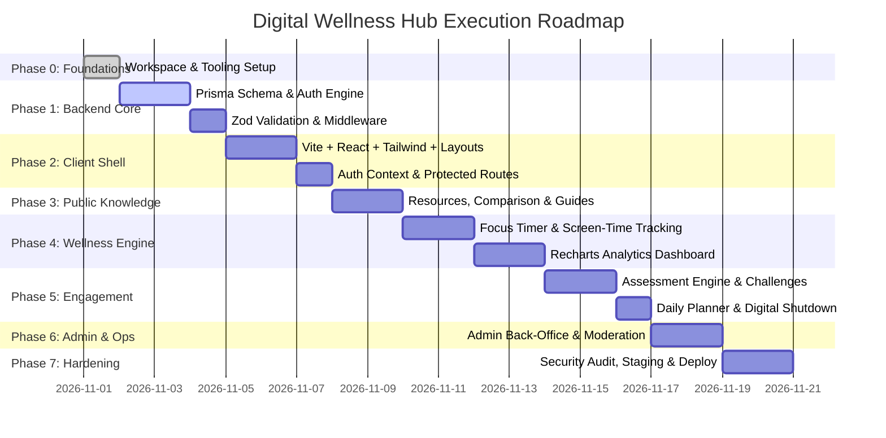

# Development Roadmap & Implementation Plan

## Digital Wellness Hub
**Project Target:** Production-Grade Capstone & Functional Web Application  
**Execution Strategy:** Incremental, Test-Driven, Milestone-Based  
**Estimated Sprints:** 7 Structured Phases

---

## 1. Project Phasing Overview



---

## 2. Detailed Phase Breakdown

### Phase 0: Workspace Scaffolding & Tooling Setup
- **Objectives:** Establish project structure with isolated `client` and `server` folders, unified TypeScript configs, and linting.
- **Tasks:**
  1. Initialize root workspace configuration.
  2. Scaffolding `client` using Vite (`npm create vite@latest client -- --template react-ts`).
  3. Scaffolding `server` using Node.js TypeScript setup (`npm init -y`, `tsconfig.json`).
  4. Configure Tailwind CSS with customized color tokens and Typography plugin in `client`.
  5. Initialize Prisma in `server` with PostgreSQL provider.
- **Acceptance Criteria:**
  - Both client and server compile without errors (`npm run build`).
  - No path resolution or dependency conflicts.

---

### Phase 1: Core Backend Infrastructure & Auth Module
- **Objectives:** Build secure authentication system, Prisma migrations, and request validation middleware.
- **Tasks:**
  1. Execute initial Prisma migration to create all database tables.
  2. Implement `argon2id` utility with secure cost parameters.
  3. Implement JWT utility for dual-token handling (Access Token + Refresh Token).
  4. Construct Auth module (Routes, Controller, Service, Repository, Zod validation).
  5. Build `auth.middleware.ts`, `role.middleware.ts`, and `error.middleware.ts`.
  6. Implement seed script (`prisma/seed.ts`) populating default categories, verified resources, sample guides, and an initial Admin account.
- **Acceptance Criteria:**
  - `POST /api/v1/auth/register` creates user with hashed password and issues HttpOnly refresh token cookie.
  - `POST /api/v1/auth/login` verifies credentials and issues tokens.
  - `POST /api/v1/auth/refresh` rotates token securely.
  - Role-based middleware blocks unauthenticated or non-admin access to protected routes.

---

### Phase 2: Frontend Foundation, Shell & Authentication UX
- **Objectives:** Construct responsive application layouts, theme navigation, authentication flows, and state management.
- **Tasks:**
  1. Build global design system atomic components: `Button`, `Input`, `Card`, `Badge`, `Modal`, `Toast`.
  2. Implement `AuthContext` with automatic token refresh on client boot.
  3. Build `LoginPage` and `RegisterPage` with form validation and error handling.
  4. Build responsive navigation: `Navbar`, `Sidebar` (collapsible for mobile), and `Footer`.
  5. Configure route guards (`ProtectedRoute`, `AdminRoute`, `PublicOnlyRoute`).
- **Acceptance Criteria:**
  - Unauthenticated users cannot view `/dashboard`.
  - Logging in stores user state in memory and navigates to the dashboard smoothly.
  - Page refresh preserves logged-in state via silent refresh.

---

### Phase 3: Public Knowledge Base (Resources, Comparisons & Guides)
- **Objectives:** Public directory enabling discovery, filtering, and side-by-side comparison of digital wellness software.
- **Tasks:**
  1. Implement Backend Resources and Categories modules with search, pagination, and multi-facet filtering.
  2. Build Frontend `ResourcesPage` with search bar, platform pills, and pricing tier toggles (`Free`, `Freemium`, `Paid`, `OSS`).
  3. Implement `ResourceComparisonModal` allowing students to compare 2–3 tools across key metrics.
  4. Implement Backend Device Guides module and Frontend `GuideViewer` component with step-by-step progress checklists.
  5. Build student community submission modal (`Suggest a Resource`).
- **Acceptance Criteria:**
  - Guest users can search and compare resources without logging in.
  - Students can submit resources that queue in pending status.

---

### Phase 4: Student Wellness Core (Focus Timer, Screen-Time & Analytics)
- **Objectives:** Provide daily operational tools for focused study and screen-time awareness.
- **Tasks:**
  1. Build interactive Focus Timer component (Pomodoro 25/5 and Custom intervals) with web audio alert notifications.
  2. Implement Pre-session Intention modal and Post-session Reflection form.
  3. Implement Backend Focus Sessions module to persist completed intervals.
  4. Build Screen-Time Logging form with categories (Study, Entertainment, Social) and goal configuration.
  5. Build Student Analytics Dashboard with Recharts:
     - 14-day Screen-Time vs. Goal line chart.
     - Weekly focus hours bar chart.
     - Daily intention summary cards.
- **Acceptance Criteria:**
  - Focus session completion saves reflection and updates dashboard analytics immediately.
  - Screen-time logs accurately compute productive vs. distracting ratios.

---

### Phase 5: Self-Assessment, Habit Challenges & Daily Planner
- **Objectives:** Diagnostics and habit formation engines.
- **Tasks:**
  1. Build 16-question Digital Wellness Assessment wizard with progress indicator.
  2. Implement backend scoring algorithm computing 0–100 index and tier classification.
  3. Render assessment results radar chart and tailored recommendations list.
  4. Implement Challenges module with streak tracking logic and milestone badges.
  5. Build Daily Planner feature with digital intention setting and evening shutdown routine.
- **Acceptance Criteria:**
  - Completing assessment yields deterministic wellness score and persists history.
  - Checking in to a challenge increments streak; missing a day handles streak reset gracefully.

---

### Phase 6: Admin Back-Office & Moderation
- **Objectives:** Administration interface for content curation and community moderation.
- **Tasks:**
  1. Build Admin verification portal listing pending community resource submissions.
  2. Implement resource approval and rejection workflows.
  3. Build CRUD interfaces for Device Guides and Challenges.
  4. Overview dashboard with aggregate platform metrics.
- **Acceptance Criteria:**
  - Only accounts with `role: ADMIN` can access `/admin/*` routes on both client and API.
  - Approved resources immediately reflect in the public directory.

---

### Phase 7: Security Hardening, Polish & Production Deployment
- **Objectives:** Production readiness, performance optimization, and cloud deployment.
- **Tasks:**
  1. Security audit: verify Helmet headers, rate limiting, and CORS origins.
  2. Optimize frontend bundle splitting in Vite config.
  3. Deploy Backend and PostgreSQL database on Render.
  4. Deploy Frontend SPA on Vercel with rewrites rule in `vercel.json`.
  5. Verify cross-origin cookie authentication in live staging environment.
  6. Final end-to-end validation across mobile and desktop browsers.
- **Acceptance Criteria:**
  - Production deployment live with HTTPS and passing health check `/api/v1/health`.
  - Zero CORS or cookie drops across Vercel and Render domains.

---

## 3. Technical Dependencies Specification

### Backend (`server/package.json`)
```json
{
  "dependencies": {
    "@prisma/client": "^5.20.0",
    "argon2": "^0.41.1",
    "cookie-parser": "^1.4.7",
    "cors": "^2.8.5",
    "dotenv": "^16.4.5",
    "express": "^4.21.1",
    "express-rate-limit": "^7.4.1",
    "helmet": "^8.0.0",
    "jsonwebtoken": "^9.0.2",
    "zod": "^3.23.8"
  },
  "devDependencies": {
    "@types/cookie-parser": "^1.4.7",
    "@types/cors": "^2.8.17",
    "@types/express": "^4.17.21",
    "@types/jsonwebtoken": "^9.0.7",
    "@types/node": "^22.7.5",
    "prisma": "^5.20.0",
    "ts-node-dev": "^2.0.0",
    "typescript": "^5.6.3"
  }
}
```

### Frontend (`client/package.json`)
```json
{
  "dependencies": {
    "clsx": "^2.1.1",
    "lucide-react": "^0.453.0",
    "react": "^18.3.1",
    "react-dom": "^18.3.1",
    "react-router-dom": "^6.27.0",
    "recharts": "^2.13.0",
    "tailwind-merge": "^2.5.4"
  },
  "devDependencies": {
    "@types/react": "^18.3.11",
    "@types/react-dom": "^18.3.1",
    "@vitejs/plugin-react": "^4.3.2",
    "autoprefixer": "^10.4.20",
    "postcss": "^8.4.47",
    "tailwindcss": "^3.4.14",
    "typescript": "^5.6.3",
    "vite": "^5.4.9"
  }
}
```

---

## 4. Implementation Risks & Mitigation Matrix

| Risk ID | Identified Risk | Impact | Likelihood | Mitigation Strategy |
| :--- | :--- | :---: | :---: | :--- |
| **RSK-01** | Cross-Origin Cookie Dropping between Vercel and Render | Critical | High | Configure `SameSite: "None"`, `Secure: true`, and explicit `Access-Control-Allow-Credentials: true` with strict CORS origin whitelist. Provide fallback Bearer token header if third-party cookies are blocked by aggressive browser tracking protection. |
| **RSK-02** | Render Free-Tier Cold Starts (Spin-down on inactivity) | Moderate | High | Implement a lightweight `/api/v1/health` ping and informative client loading state with graceful retry logic. |
| **RSK-03** | Scope Creep in Assessment / Analytics Complexity | Moderate | Medium | Strictly bound assessment to a static 16-question validated rubric; do not introduce complex dynamic graph dependencies or AI inference. |
| **RSK-04** | Token Replay / Stolen Refresh Tokens | High | Low | Enforce database-backed single-use refresh token rotation; immediately revoke entire token family if a previously used token is presented. |
| **RSK-05** | Sensitive Student Habit Data Exposure | High | Low | Data minimization: store only necessary aggregations; enforce strict user ownership checks (`userId === req.user.id`) in all service queries. |
