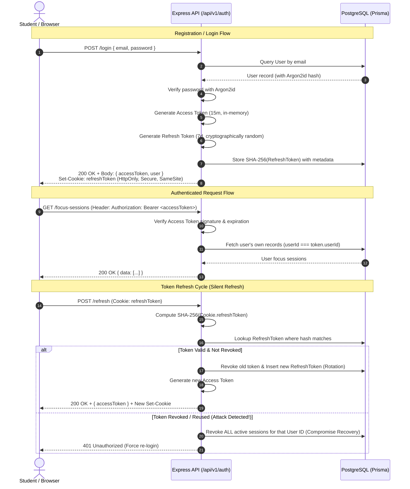

# Security Architecture & Requirements Specification

## Digital Wellness Hub
**Document Version:** 1.0.0  
**Security Standard:** OWASP Top 10 Aligned  
**Key Cryptographic Primitives:** Argon2id, RS256 / HS256 JWT, SHA-256 Hashes

---

## 1. Threat Model & Core Principles

Digital Wellness Hub handles personal behavioral data of university students (focus intervals, screen-time habits, wellness scores, and personal reflections). Although not medical health records under HIPAA, this self-reported data is deeply personal. Our security posture adheres to four non-negotiable principles:

1. **Defense in Depth:** Security controls are enforced in concentric rings—network transport, API gateway, controller validation, service-level ownership checks, and database constraints.
2. **Principle of Least Privilege:** Users operate with the minimal necessary permissions (`GUEST` -> `STUDENT` -> `ADMIN`). Database credentials use connection-restricted privileges.
3. **Fail-Safe Defaults:** Routes are denied by default unless explicitly public or matched by an authorized role.
4. **Data Minimization & Ethical Privacy:** The platform never snoops on background processes, browser URLs, or keystrokes. All wellness metrics are intentionally user-reported.

---

## 2. Authentication & Credential Security



### 2.1 Password Hashing with Argon2id
Passwords are never stored in plaintext or weak legacy hashes (MD5, SHA-1, standard bcrypt). We mandate **Argon2id**, the winner of the Password Hashing Competition (PHC), which provides maximum resistance against both GPU brute-forcing and side-channel timing attacks.

- **Algorithm:** Argon2id
- **Memory Cost (`m`):** `65536` KiB (64 MiB)
- **Time Cost (`t`):** `3` iterations
- **Parallelism (`p`):** `4` threads/lanes
- **Salt:** 16 bytes generated by a cryptographically secure pseudo-random number generator (CSPRNG).

### 2.2 Dual-Token Architecture

#### Access Token:
- **Format:** Signed JSON Web Token (JWT).
- **Lifespan:** 15 minutes.
- **Payload:** Restricted to minimal claims: `{ sub: userId, email: userEmail, role: userRole, iat, exp }`.
- **Storage:** Client in-memory state (`AuthContext`). **NEVER stored in `localStorage` or `sessionStorage`** to prevent theft via XSS.

#### Refresh Token:
- **Format:** 64-character high-entropy random string generated via Node.js `crypto.randomBytes(32).toString('hex')`.
- **Lifespan:** 7 days.
- **Database Storage:** Stored as `SHA-256` hash in the `refresh_tokens` table. In the event of an unauthorized database dump, raw refresh tokens cannot be weaponized.
- **Client Delivery:** Placed exclusively in an `HttpOnly`, `Secure`, `SameSite=None` (production) or `SameSite=Lax` (local development) cookie.

#### Single-Use Token Rotation & Theft Detection:
Every refresh request burns the current refresh token and issues a new pair. If a previously burned refresh token is submitted (indicating a replay attack or token theft), the backend immediately flags the entire token family as compromised and revokes all active sessions for that user ID.

---

## 3. Role-Based Authorization (RBAC) & Ownership Verification

### 3.1 Role Hierarchy
- `GUEST`: Unauthenticated visitor. Restricted to public read endpoints.
- `STUDENT`: Authenticated student. Full access to create, read, update, and delete their own wellness data.
- `ADMIN`: Platform curator. Access to student moderation, resource verification, and platform-wide metrics.

### 3.2 Enforcement Pattern
Authorization is enforced using reusable Express middlewares:

```typescript
// Example Middleware Signature
router.get(
  '/admin/pending-resources',
  authenticateToken,
  requireRole(['ADMIN']),
  adminController.getPendingResources
);
```

### 3.3 Strict Tenant Data Isolation (Horizontal Authorization)
A common vulnerability is Broken Object Level Authorization (BOLA/IDOR), where Student A accesses Student B's data by guessing IDs. Digital Wellness Hub enforces horizontal tenant boundaries inside the Service layer:
- The `userId` is extracted **exclusively from `req.user.id`** (the cryptographically verified JWT payload), never accepted blindly from client request parameters.
- Example: `focusService.getSessions(userId: string)` always filters `WHERE userId = req.user.id`.

---

## 4. Input Validation & Injection Defenses

### 4.1 Strict Zod Request Validation
Every API endpoint has a dedicated Zod schema for incoming data:
- `validateBody(schema)`: Rejects unexpected fields (`.strict()`), strips malicious payloads, and formats types before passing to the controller.
- `validateQuery(schema)`: Validates pagination bounds (`limit` clamped between 1 and 100), sorting keys, and filter values.
- `validateParams(schema)`: Enforces valid CUID or UUID formats for path variables.

### 4.2 SQL Injection Prevention
Direct SQL string concatenation is strictly prohibited. All persistent operations use **Prisma ORM**, which utilizes parameterized prepared statements for all database queries, neutralizing SQL injection vectors.

### 4.3 Cross-Site Scripting (XSS) Defenses
1. **React Automatic Escaping:** React automatically escapes values in JSX templates.
2. **HttpOnly Cookies:** Authentication refresh tokens are completely invisible to JavaScript running in the browser, rendering DOM-based XSS attacks incapable of exfiltrating credentials.
3. **Content-Security-Policy (CSP):** Enforced via Helmet.js, restricting script sources to trusted origins.

---

## 5. Transport Layer & API Hardening

### 5.1 Helmet.js Security Headers
The Express API applies standard HTTP security headers:
- `Content-Security-Policy`: Blocks unauthorized scripts and inline execution.
- `Strict-Transport-Security (HSTS)`: `max-age=31536000; includeSubDomains; preload` forces browsers to communicate solely over HTTPS.
- `X-Content-Type-Options`: `nosniff` prevents MIME-type sniffing.
- `X-Frame-Options`: `DENY` prevents clickjacking by forbidding embedding in iframes.
- `Referrer-Policy`: `strict-origin-when-cross-origin`.

### 5.2 CORS (Cross-Origin Resource Sharing) Policy
To allow communication between the Vercel frontend and Render backend while preventing unauthorized cross-origin abuse:
- Only explicitly whitelisted client origins (e.g. `https://digital-wellness-hub.vercel.app` and `http://localhost:5173`) are permitted.
- `credentials: true` is strictly scoped to allow cookie transmission only from whitelisted origins. Wildcard `*` origins are forbidden.

### 5.3 Rate Limiting & Denial-of-Service Defense
API endpoints are protected by `express-rate-limit`:
- **Auth Routes (`/api/v1/auth/*`):** 5 requests per 15-minute window per IP to eliminate brute-force and credential-stuffing attacks.
- **General API Routes (`/api/v1/*`):** 100 requests per 15-minute window per IP.

### 5.4 Centralized Error Masking
In production (`NODE_ENV === 'production'`), error middleware suppresses internal system details:
- Stack traces, database column names, and file paths are logged internally on the server but never returned in JSON response envelopes.
- Clients receive clean, actionable error messages with safe error codes (`VALIDATION_ERROR`, `RESOURCE_NOT_FOUND`, `UNAUTHORIZED`).

---

## 6. Student Data Privacy & GDPR/FERPA Principles

1. **Right to Access / Data Portability:** Students have an immediate endpoint (`GET /api/v1/users/me/export`) to download their complete focus history, screen-time logs, assessment records, and planner notes in standardized JSON format.
2. **Right to Erasure (Account Deletion):** Students can delete their account at any time (`DELETE /api/v1/users/me`). The backend executes a cascading delete removing all personal records from the database.
3. **No Third-Party Tracker SDKs:** No third-party behavioral analytics or advertising trackers (Google Analytics, Meta Pixel, Hotjar) are integrated. All system metrics are internal and aggregate.
